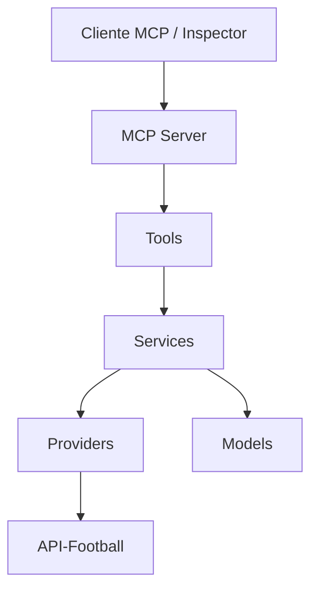

# MCP Lab Python ⚽

Laboratório prático para aprender **Model Context Protocol (MCP)** utilizando Python, integração com APIs REST e arquitetura modular.

O primeiro módulo implementado é uma integração com a **API-Football**, permitindo consultar partidas e resultados de campeonatos de futebol.

## Objetivos

- Entender como funciona um MCP Server.
- Desenvolver ferramentas MCP com Python.
- Integrar serviços externos por meio de APIs REST.
- Aplicar separação de responsabilidades.
- Criar testes automatizados.
- Explorar a comunicação MCP utilizando o MCP Inspector.

## Arquitetura



O projeto está organizado em camadas:

| Camada | Responsabilidade |
|---|---|
| Server | Inicialização e registro das ferramentas MCP |
| Tools | Interface disponibilizada aos clientes MCP |
| Services | Lógica de negócio e transformação de dados |
| Providers | Comunicação com APIs externas |
| Models | Representação padronizada das entidades |

## Estrutura do projeto

```text
mcp-lab-python/
├── modules/
│   └── football/
│       ├── models/
│       │   ├── campeonato.py
│       │   └── partida.py
│       ├── providers/
│       │   └── api_football.py
│       ├── services/
│       │   ├── campeonatos_service.py
│       │   └── partidas_service.py
│       └── tools/
│           └── partidas.py
├── tests/
│   ├── test_api_football.py
│   └── test_partidas_service.py
├── server.py
├── pyproject.toml
├── .env.example
└── .gitignore
```

## Requisitos

- Python 3.11 ou superior
- Git
- Node.js e NPX para utilizar o MCP Inspector
- Conta e API Key da API-Football

## Instalação

Os comandos abaixo são destinados ao Git Bash no Windows.

### 1. Clonar o repositório

```bash
git clone URL_DO_REPOSITORIO
cd mcp-lab-python
```

Substitua `URL_DO_REPOSITORIO` pelo endereço do repositório publicado no GitHub.

### 2. Criar e ativar o ambiente virtual

```bash
py -m venv .venv
source .venv/Scripts/activate
```

### 3. Instalar as dependências

```bash
python -m pip install -e ".[dev]"
```

### 4. Configurar a API Key

Copie o arquivo de exemplo:

```bash
cp .env.example .env
```

Edite o arquivo `.env` e configure:

```dotenv
API_FOOTBALL_KEY=SUA_CHAVE_AQUI
```

A chave pode ser obtida em https://www.api-football.com/.

**Nunca publique sua API Key no GitHub.**

## Executando o MCP Server

Para iniciar diretamente o servidor:

```bash
python server.py
```

O transporte utilizado no laboratório é `stdio`. Normalmente, o servidor é iniciado e gerenciado por um cliente MCP.

## Testando com o MCP Inspector

Execute:

```bash
npx @modelcontextprotocol/inspector python server.py
```

Abra a interface indicada no terminal, conecte-se ao servidor e selecione a ferramenta `consultar_jogos`.

Exemplo de parâmetros:

```json
{
  "campeonato_id": 71,
  "temporada": 2024,
  "limite": 5
}
```

Para descobrir as ferramentas pela linha de comando:

```bash
npx @modelcontextprotocol/inspector --cli .venv/Scripts/python.exe server.py --method tools/list --format json --connect-timeout 30000
```

## Ferramentas MCP disponíveis

### consultar_jogos

Consulta partidas de uma competição em uma temporada.

| Parâmetro | Tipo | Descrição |
|---|---|---|
| campeonato_id | int | Identificador da competição |
| temporada | int | Ano da temporada |
| limite | int | Máximo de partidas retornadas, entre 1 e 20 |

Identificadores conhecidos:

- Brasileirão Série A: `71`
- Copa do Brasil: `73`

**Limitação:** a conta gratuita utilizada durante o desenvolvimento permitiu consultar a temporada de 2024, mas restringiu o acesso a 2026. A disponibilidade depende do plano e do provedor.

## Testes automatizados

Execute:

```bash
python -m pytest -v
```

Os testes utilizam respostas simuladas para validar o Service e o Provider sem realizar requisições reais à API-Football.

## Segurança

- Credenciais são carregadas por variáveis de ambiente.
- O arquivo `.env` não deve ser versionado.
- Nunca inclua tokens ou chaves reais em commits.
- Dados sensíveis não devem ser adicionados ao repositório público.

## Próximas evoluções

- [x] Implementar Provider da API-Football
- [x] Criar Models e Services
- [x] Disponibilizar a primeira ferramenta MCP
- [x] Testar com MCP Inspector
- [x] Criar testes automatizados
- [ ] Adicionar filtros por data e rodada
- [ ] Criar catálogo de campeonatos
- [ ] Adicionar classificação dos campeonatos
- [ ] Criar testes da interface MCP
- [ ] Implementar cache e tratamento de limites da API
- [ ] Documentar a comunicação JSON-RPC

## Licença

A licença do projeto será definida antes da publicação pública.